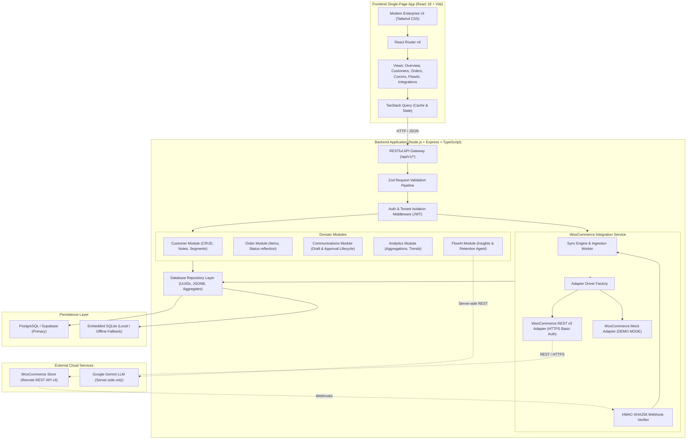
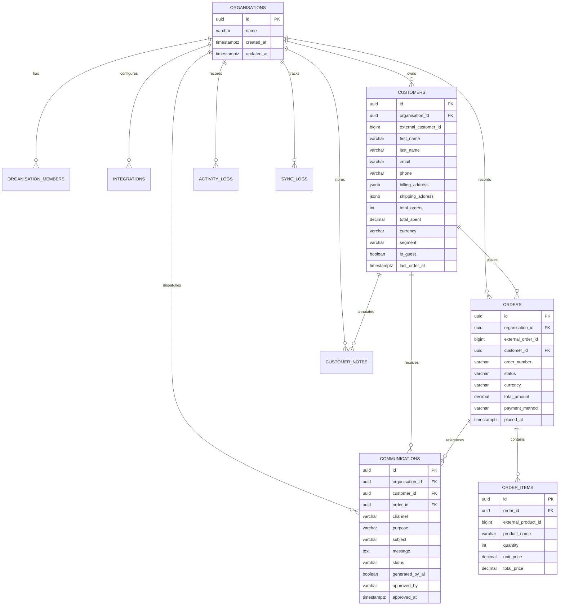
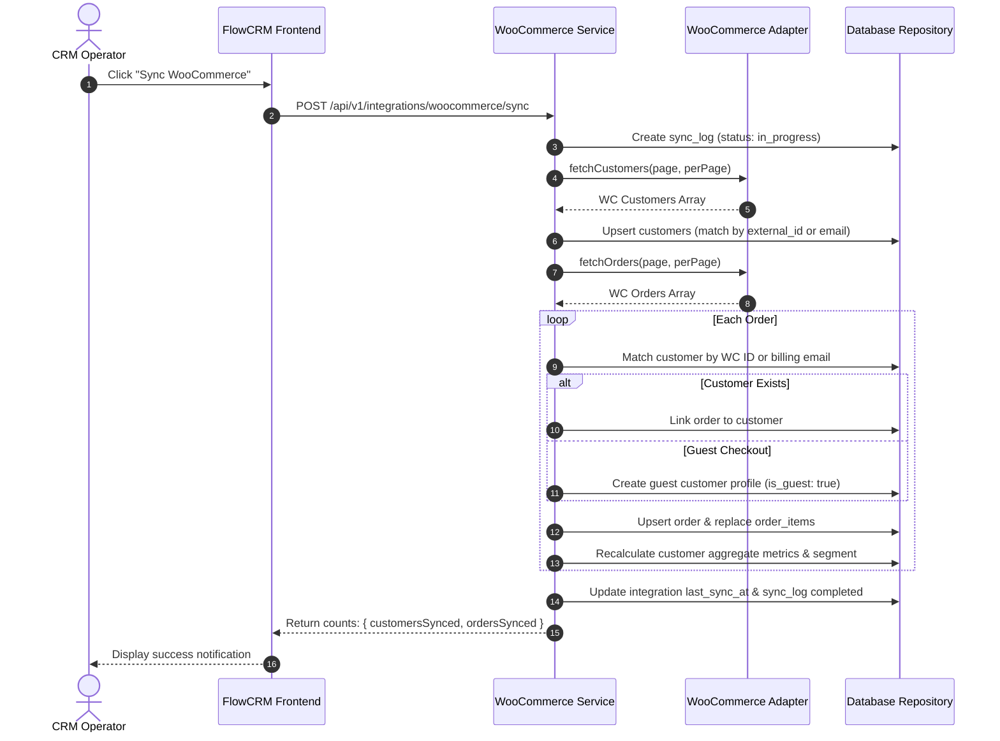
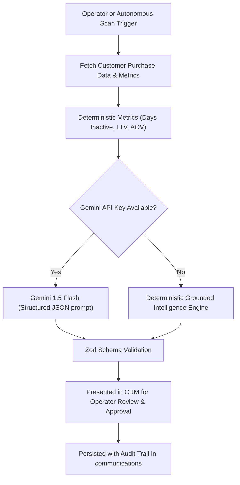

# FlowCRM — Architecture Documentation

## 1. System Architecture Overview

FlowCRM is built as a production-oriented modular monolith. It provides a full-stack, multi-tenant B2B SaaS architecture designed specifically for WooCommerce store operators. It reconciles e-commerce transactional data with customer relationship management, deterministic segmentation, draft-and-approval communication workflows, and server-side artificial intelligence.

---

## 2. Multi-Tenant Organization Isolation

Every CRM entity belongs strictly to an `organisation_id`:
- Authentication tokens (Supabase JWT or developer JWT) carry the user's `userId`, `email`, and `orgId`.
- The `requireAuth` middleware verifies the token and validates that the user is an active member of `organisation_members` for the target organization.
- Cross-tenant queries are blocked at the repository layer where every database query requires `WHERE organisation_id = $1`.
- Requests attempting to read or write data belonging to another tenant fail with HTTP 401/403.

---

## 3. Relational Database Design

The schema is composed of 10 relational tables:

---

## 4. WooCommerce Integration Engine

### Dual-Mode Architecture
1. **Live REST API v3 Adapter (`WooCommerceRestAdapter`)**:
   - Communicates over authenticated HTTPS with `/wp-json/wc/v3/customers` and `/wp-json/wc/v3/orders`.
   - Handles pagination via `page` and `per_page` query parameters and `X-WP-Total` response headers.
   - Resilient retry on HTTP 429 (Rate Limiting).
2. **Mock Adapter (`WooCommerceMockAdapter` [DEMO MODE])**:
   - Zero-dependency realistic mock store that generates real e-commerce line items, varying order statuses, repeat customers, churn risks, and guest checkouts.
   - Matches the official WooCommerce REST API v3 schema.

### Ingestion & Idempotent Upsert Workflow

---

## 5. FlowAI — Customer Intelligence Assistant

The AI architecture enforces strict business rules:
- **Server-side execution only**: Credentials never reach the browser.
- **Strictly Grounded**: Summaries are generated exclusively from verified purchase frequencies, intervals, and monetary values.
- **Human-in-the-Loop**: Generated drafts require explicit operator approval before transition to `approved` or `sent`.
- **Heuristic Fallback**: Operates reliably even without third-party API keys.

