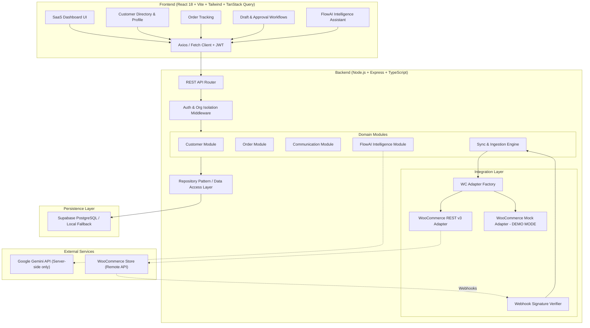

# FlowCRM — Master Implementation Plan

## 1. Executive Summary & Objective

**FlowCRM** is a production-grade, lightweight, intelligent B2B SaaS Customer Relationship Management system purpose-built for WooCommerce store operators. It bridges e-commerce transactional data with actionable customer relationship management, deterministic segmentation, draft-and-approval communication workflows, and server-side AI intelligence (FlowAI).

This document establishes the architecture, database design, API specification, integration strategy, and phased execution timeline for the 4-hour placement hackathon organized by Kilowott.

---

## 2. Finalised MVP Scope

### P0 — Mandatory (Core Foundation)
1. **Authentication & Multi-Tenant Isolation**:
   - Supabase Auth integration with JWT verification middleware.
   - Organization-based scoping: Every entity (customers, orders, communications, notes, integrations) belongs strictly to an `organisation_id`.
   - Safe local/developer mode fallback for immediate evaluation.
2. **WooCommerce Integration Service**:
   - Dual-mode architecture:
     - **Live REST API v3**: Direct HTTPS client communicating with `/wp-json/wc/v3/customers` and `/wp-json/wc/v3/orders`.
     - **Mock Adapter (DEMO MODE)**: Deterministic, realistic e-commerce datasets reflecting diverse customer behaviors (new, high-value, repeat, churning, guest checkouts) clearly marked as `[DEMO MODE]`.
   - Idempotent synchronisation engine preventing duplicate records.
   - Guest checkout reconciliation (associates orders by email without overwriting user data).
   - Webhook endpoint (`/api/v1/integrations/woocommerce/webhook`) with HMAC-SHA256 signature verification.
3. **Database Persistence**:
   - PostgreSQL schema with 10 tables, proper foreign keys, constraints, and indexes.
   - Abstraction supporting Supabase PostgreSQL as well as a zero-dependency local SQLite/PostgreSQL store for instant offline reliability.
4. **Customer Management**:
   - Directory with full-text search, sorting, filtering, and pagination.
   - Comprehensive customer profile: billing/shipping addresses, purchase history timeline, internal notes CRUD, communication history, AI insights.
   - Deterministic customer segmentation engine (New, Repeat, High-Value, Inactive).
5. **Order Tracking**:
   - Order list with status badges, search, date sorting, and customer cross-links.
   - Order detail drawer/modal with itemized products, quantities, prices, currency preservation, and WooCommerce status mapping.
6. **Communication Workflows**:
   - Draft-and-approval workflow (`draft` -> `pending_approval` -> `approved` -> `sent` / `failed`).
   - Multiple communication purposes: Order follow-up, Thank-you message, Customer re-engagement, Support response.
7. **FlowCRM Dashboard**:
   - Core metrics: Total Customers, Total Orders, Total Revenue, Average Order Value (AOV).
   - Visualizations: Revenue trends, Order status distribution, Customer acquisition trends via Recharts.
   - Live integration health and sync trigger.

### P1 — High-Value AI & Intelligence
1. **FlowAI Customer Intelligence**:
   - Server-side integration with structured JSON outputs validated via Zod.
   - **Capability A (Customer Insights)**: Grounded analytical summary of customer order history, frequency, and churn risk.
   - **Capability B (Personalized Communication Generator)**: Contextual draft generator respecting order status, customer name, and purpose.
   - **Capability C (Customer Retention Agent)**: Autonomous heuristic scan to identify churning customers and formulate a tailored recovery offer for human operator approval.

---

## 3. System Architecture



---

## 4. Relational Database Schema

### Table Definitions
1. **organisations**: `id (UUID PK)`, `name (TEXT)`, `created_at`, `updated_at`
2. **organisation_members**: `id (UUID PK)`, `organisation_id (FK)`, `user_id (TEXT)`, `role (TEXT)`, `created_at`
3. **integrations**: `id (UUID PK)`, `organisation_id (FK)`, `provider (TEXT)`, `store_url (TEXT)`, `encrypted_credentials (JSONB)`, `connection_status (TEXT)`, `last_sync_at (TIMESTAMPTZ)`, `created_at`, `updated_at`
4. **customers**: `id (UUID PK)`, `organisation_id (FK)`, `external_customer_id (BIGINT NULL)`, `first_name (TEXT)`, `last_name (TEXT)`, `email (TEXT)`, `phone (TEXT)`, `billing_address (JSONB)`, `shipping_address (JSONB)`, `total_orders (INT)`, `total_spent (DECIMAL(12,2))`, `currency (VARCHAR(3))`, `segment (TEXT)`, `last_order_at (TIMESTAMPTZ)`, `created_at`, `updated_at`
5. **orders**: `id (UUID PK)`, `organisation_id (FK)`, `external_order_id (BIGINT)`, `customer_id (FK NULL)`, `order_number (TEXT)`, `status (TEXT)`, `currency (VARCHAR(3))`, `total_amount (DECIMAL(12,2))`, `payment_method (TEXT)`, `placed_at (TIMESTAMPTZ)`, `created_at`, `updated_at`
6. **order_items**: `id (UUID PK)`, `order_id (FK)`, `external_product_id (BIGINT NULL)`, `product_name (TEXT)`, `quantity (INT)`, `unit_price (DECIMAL(12,2))`, `total_price (DECIMAL(12,2))`
7. **communications**: `id (UUID PK)`, `organisation_id (FK)`, `customer_id (FK)`, `order_id (FK NULL)`, `channel (TEXT)`, `purpose (TEXT)`, `subject (TEXT)`, `message (TEXT)`, `status (TEXT)`, `generated_by_ai (BOOLEAN)`, `created_at`, `updated_at`
8. **customer_notes**: `id (UUID PK)`, `organisation_id (FK)`, `customer_id (FK)`, `author_id (TEXT)`, `content (TEXT)`, `created_at`, `updated_at`
9. **activity_logs**: `id (UUID PK)`, `organisation_id (FK)`, `actor_id (TEXT)`, `entity_type (TEXT)`, `entity_id (TEXT)`, `action (TEXT)`, `metadata (JSONB)`, `created_at`
10. **sync_logs**: `id (UUID PK)`, `organisation_id (FK)`, `integration_id (FK)`, `sync_type (TEXT)`, `status (TEXT)`, `records_processed (INT)`, `error_message (TEXT NULL)`, `started_at (TIMESTAMPTZ)`, `completed_at (TIMESTAMPTZ)`

### Indexes & Constraints
- `UNIQUE(organisation_id, external_customer_id)` WHERE external_customer_id IS NOT NULL
- `UNIQUE(organisation_id, external_order_id)`
- `INDEX idx_customers_org_email ON customers (organisation_id, email)`
- `INDEX idx_orders_org_customer ON orders (organisation_id, customer_id)`
- `INDEX idx_orders_placed_at ON orders (organisation_id, placed_at)`

---

## 5. WooCommerce Integration Strategy

### Dual-Mode Adapter Interface
```typescript
export interface IWooCommerceAdapter {
  testConnection(): Promise<{ success: boolean; storeName?: string; error?: string }>;
  fetchCustomers(page: number, perPage: number): Promise<{ customers: WCExternalCustomer[]; total: number }>;
  fetchOrders(page: number, perPage: number): Promise<{ orders: WCExternalOrder[]; total: number }>;
  fetchOrderById(id: number | string): Promise<WCExternalOrder>;
}
```

### Upsert & Reconciliation Logic
1. **Customers**:
   - Query existing customer by `(organisation_id, external_customer_id)` or `(organisation_id, email)`.
   - Update address and contact details without overriding local internal notes.
2. **Orders**:
   - Look up customer by `order.customer_id` (WooCommerce ID) or `order.billing.email`.
   - If no customer exists (Guest Checkout), create customer tagged with `is_guest: true`.
   - Upsert order into `orders` and replace `order_items`.
   - Recalculate customer aggregate statistics (`total_orders`, `total_spent`, `last_order_at`, `segment`).
3. **Webhooks**:
   - `/api/v1/integrations/woocommerce/webhook`
   - Verifies `X-WC-Webhook-Signature` HMAC-SHA256 signature against webhook secret.
   - Dispatches `order.created`, `order.updated`, `customer.created`, `customer.updated` idempotently.

---

## 6. Four-Hour Execution Strategy

| Phase | Duration | Milestones & Deliverables |
|---|---|---|
| **Phase 1: Planning** | 0 – 30 min | MVP definition, database schema, architecture specification, plan approval. |
| **Phase 2: Core Backend & Integration** | 30 – 120 min | Scaffold backend & frontend; implement SQL schema/repositories; create Auth & Org middleware; build WooCommerce Live & Mock Adapters; implement Sync Engine, Customer, Order, Communication, and FlowAI endpoints; verify with Supertest. |
| **Phase 3: Frontend & AI Experience** | 120 – 175 min | Build modern SaaS UI (collapsible sidebar, responsive header, dark/light theme); Dashboard metrics & charts (Recharts); Customer Directory & Profile with Notes; Order Tracking & Item Details; Communication Draft & Approval Drawer; FlowAI Assistant component. |
| **Phase 4: Testing & Hardening** | 175 – 210 min | Automated tests (Vitest + Supertest); verify organization isolation; check mock vs live sync; validate Zod schema error handling; build verification (`tsc` & `vite build`). |
| **Phase 5: Documentation & Submission** | 210 – 240 min | Complete README.md, ARCHITECTURE.md, API.md, ASSUMPTIONS.md, AI_USAGE.md, .env.example; prepare sample seed data for instant 2-minute live demo. |

---

## 7. Immediate Development Tasks
1. Initialize Git repository and create directory structure (`backend/`, `frontend/`, `docs/`).
2. Scaffold `package.json` for backend and frontend with exact modern dependency versions.
3. Create PostgreSQL schema migration and unified data repository layer.
4. Implement the WooCommerce adapter (Live + Mock) and synchronisation pipeline.
