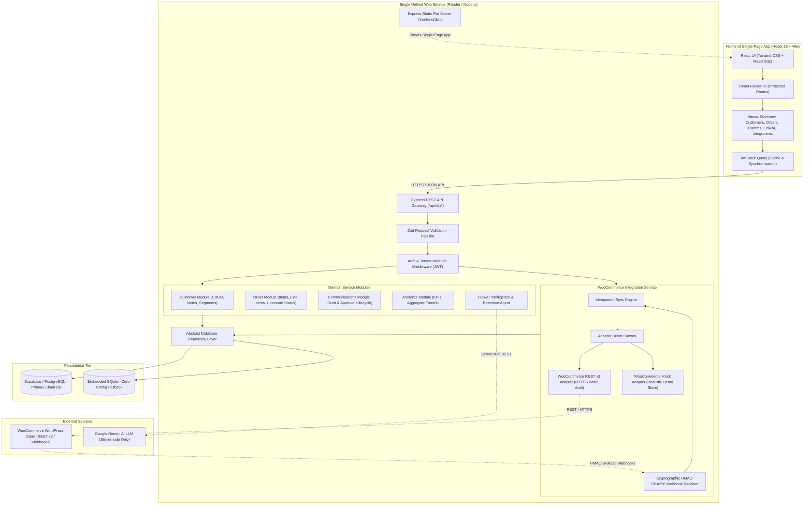
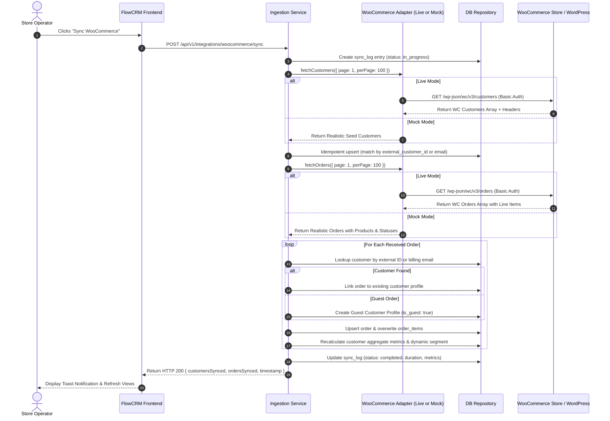
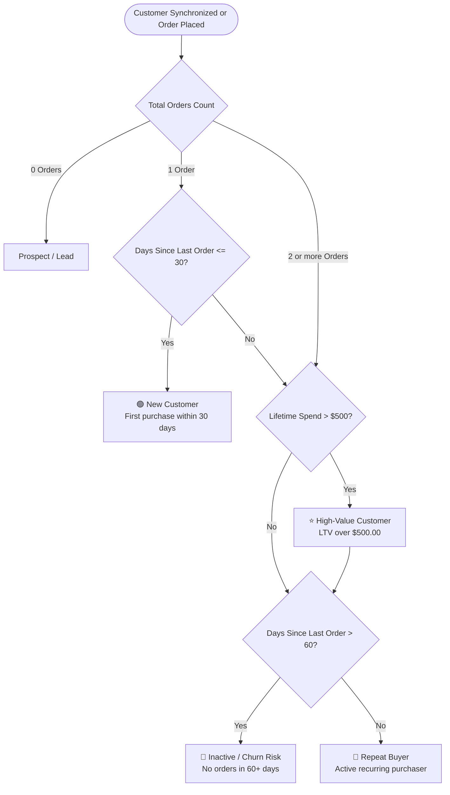
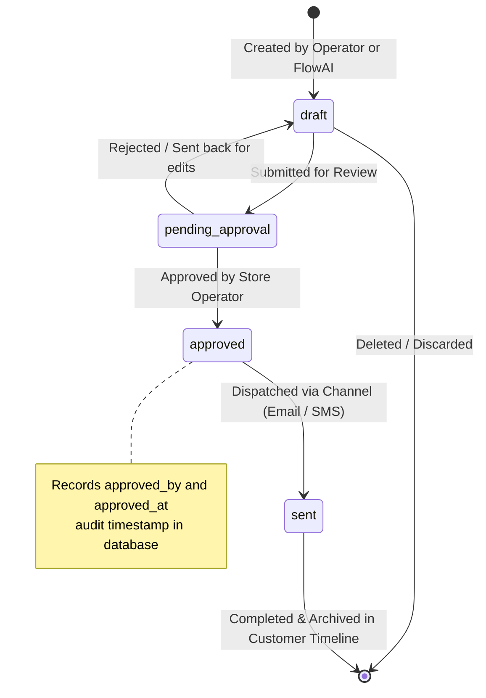
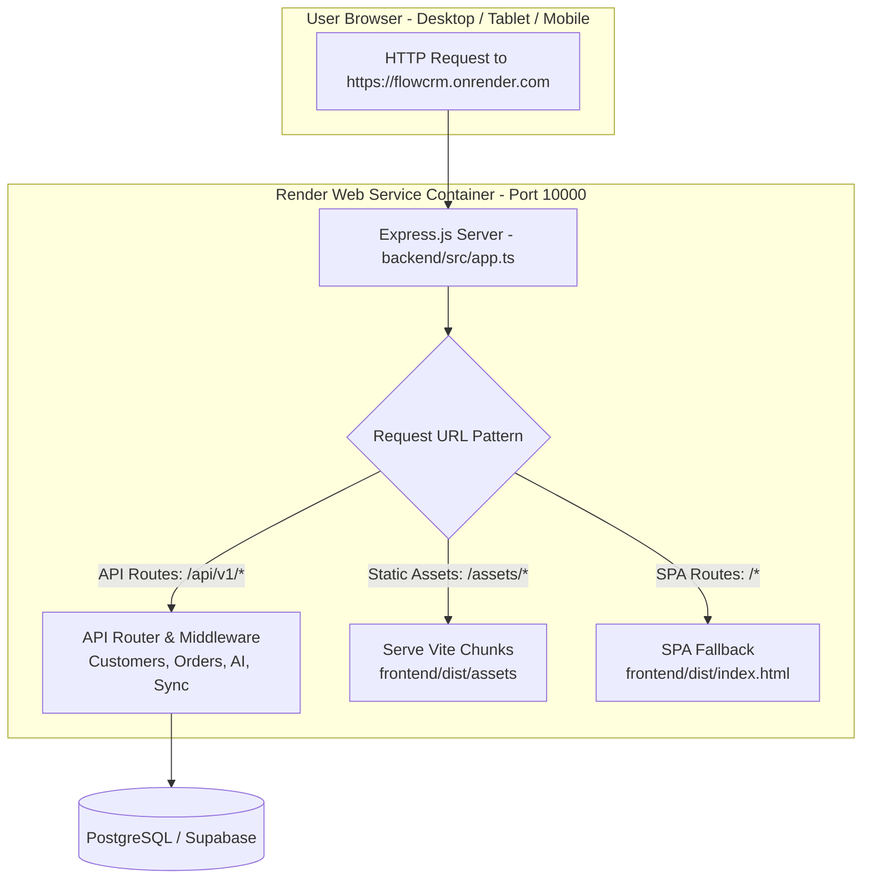

# FlowCRM — Intelligent Customer Relationship Management for WooCommerce

<div align="center">


**A production-ready, full-stack B2B SaaS Customer Relationship Management system designed specifically for WooCommerce store operators.**

[](https://www.typescriptlang.org/)
[](https://reactjs.org/)
[](https://nodejs.org/)
[](https://expressjs.com/)
[](https://tailwindcss.com/)
[](https://supabase.com/)
[](https://render.com/)
[-brightgreen?style=flat-square&logo=vitest&logoColor=white)](https://vitest.dev/)
[](https://opensource.org/licenses/MIT)

[Live Demo & Fast-Track Login](#-instant-fast-track-demo) • [Architecture Diagrams](#-system-architecture--flow-diagrams) • [Key Features](#-core-feature-modules) • [Live WooCommerce Setup](#-live-woocommerce-connection-guide) • [Render Deployment](#-production-deployment-on-render) • [API Specification](#-restful-api-reference)

</div>

---

## 📖 Table of Contents

- [1. Executive Summary & Problem Solved](#-executive-summary--problem-solved)
- [2. Instant Fast-Track Demo](#-instant-fast-track-demo)
- [3. System Architecture & Flow Diagrams](#-system-architecture--flow-diagrams)
  - [System Architecture & Cloud Topology](#1-system-architecture--cloud-topology)
  - [WooCommerce Dual-Mode & Ingestion Pipeline](#2-woocommerce-dual-mode--ingestion-pipeline)
  - [Deterministic Customer Segmentation Flow](#3-deterministic-customer-segmentation-flow)
  - [Communication Draft-and-Approval State Machine](#4-communication-draft-and-approval-state-machine)
  - [FlowAI Autonomous Retention Agent Pipeline](#5-flowai-autonomous-retention-agent-pipeline)
  - [Render Single-Service Unified Serving](#6-render-single-service-unified-serving)
- [4. Core Feature Modules](#-core-feature-modules)
  - [👥 Customer 360 & Directory Search](#-customer-360--directory-search)
  - [📊 Deterministic Segmentation Engine](#-deterministic-segmentation-engine)
  - [📦 Order Tracking & Inspection](#-order-tracking--inspection)
  - [✉️ Draft & Approval Communication Workflows](#️-draft--approval-communication-workflows)
  - [🤖 FlowAI Customer Intelligence Assistant](#-flowai-customer-intelligence-assistant)
  - [🛒 Dual-Mode WooCommerce Integration](#-dual-mode-woocommerce-integration)
  - [🔒 Multi-Tenant Auth with 1-Click Fast-Track Demo](#-multi-tenant-auth-with-1-click-fast-track-demo)
  - [✨ Modern React Bits UI & Mobile Responsiveness](#-modern-react-bits-ui--mobile-responsiveness)
- [5. Live WooCommerce Connection Guide](#-live-woocommerce-connection-guide)
- [6. Technology Stack](#-technology-stack)
- [7. Quick Start & Local Setup](#-quick-start--local-setup)
- [8. Production Deployment on Render](#-production-deployment-on-render)
- [9. Automated Verification & Test Suite](#-automated-verification--test-suite)
- [10. RESTful API Reference](#-restful-api-reference)
- [11. Repository Structure](#-repository-structure)
- [12. License](#-license)

---

## 💡 Executive Summary & Problem Solved

WooCommerce powers millions of e-commerce storefronts globally, but operates strictly as a transactional catalog. Store operators struggle with four critical operational blind spots:

1. **Silent Customer Churn:** Purchase intervals are not tracked, meaning high-value customers lapse without the merchant noticing.
2. **Fragmented Customer Context:** Customer support and sales staff must switch across dozens of disconnected order pages to answer simple questions.
3. **Ungrounded Marketing Outreach:** Follow-ups are either manual and repetitive or blasted through generic, non-contextual email blasts.
4. **Lack of Operational Governance:** AI tools often generate hallucinated content or trigger unsupervised automated outreach without merchant approval.

### The FlowCRM Solution

**FlowCRM** transforms WooCommerce data into an actionable intelligence system. It unifies customer profiles, tracks real-time order history, computes dynamic RFM customer segments, provides human-in-the-loop communication approval workflows, and leverages server-side Google Gemini AI to proactively diagnose customer churn and draft grounded recovery offers.

> [!NOTE]
> **Built for Evaluation:** FlowCRM includes a zero-dependency **Realistic Mock Store Adapter** and an **Instant 1-Click Demo Login** so reviewers, evaluators, and recruiters can inspect the full application immediately without signing up or configuring external APIs.

---

## ⚡ Instant Fast-Track Demo

You can test FlowCRM locally or on any hosted URL in **under 5 seconds**:

1. Open the application URL (e.g. `http://localhost:5173` or your hosted Render URL).
2. On the login screen, click the **"⚡ Instant 1-Click Demo Login"** button.
3. The system automatically provisions a demo JWT session and takes you straight into the live dashboard with pre-seeded customers, orders, and AI intelligence.
4. Test the **"Sync WooCommerce"** button in the header to run live ingestion!

---

## 📐 System Architecture & Flow Diagrams

### 1. System Architecture & Cloud Topology

FlowCRM is designed as a modular monolith with strict domain boundaries, tenant isolation, and multi-tier database fallback:



---

### 2. WooCommerce Dual-Mode & Ingestion Pipeline

FlowCRM seamlessly connects to real WooCommerce stores or runs in realistic mock mode with zero external dependencies:



---

### 3. Deterministic Customer Segmentation Flow

Customers are automatically categorized into deterministic business segments upon every order update or sync:



---

### 4. Communication Draft-and-Approval State Machine

To prevent accidental, unverified, or AI-hallucinated outreach from leaving the CRM, FlowCRM strictly enforces a human-in-the-loop state machine with full operator audit logging:



---

### 5. FlowAI Autonomous Retention Agent Pipeline

FlowAI scans store metrics to uncover churning high-value customers, diagnose root causes, generate targeted win-back offers, and prepare communication drafts for 1-click human approval:

```mermaid
flowchart LR
    ScanTrigger["🔍 Retention Scan Triggered"] --> FilterCustomers["Filter Customers:<br/>• LTV over $500<br/>• Inactive over 60 Days"]
    FilterCustomers --> ComputeSignals["Extract Purchase Signals:<br/>• Preferred Categories<br/>• Order Cadence<br/>• Days Silent"]
    
    ComputeSignals --> EngineSelect{"Google Gemini API<br/>Configured?"}
    
    EngineSelect -- "Yes" --> GeminiPrompt["Prompt Gemini 1.5 Flash<br/>Strict JSON Schema"]
    EngineSelect -- "No" --> HeuristicEngine["Deterministic Grounded<br/>Intelligence Engine"]
    
    GeminiPrompt --> ZodValidation["Zod Schema Parse<br/>& Safety Sanitization"]
    HeuristicEngine --> ZodValidation

    ZodValidation --> FormulateOffer["Formulate Targeted Incentive<br/>15-20% VIP Recovery Offer"]
    FormulateOffer --> AutoDraft["Persist Draft in Database<br/>status: pending_approval"]
    AutoDraft --> OperatorReview["👤 Operator Reviews in FlowAI Screen<br/>1-Click Approve or Edit"]
```



---

### 6. Render Single-Service Unified Serving

FlowCRM deploys onto Render as a **single unified Web Service**, eliminating cross-origin CORS latency and reducing hosting costs to 100% free tier:



---

## 🚀 Core Feature Modules

### 👥 Customer 360 & Directory Search
- **Instant Search:** Debounced full-text search across customer first name, last name, email address, and phone number.
- **Customer 360 Profile:** Single-pane view showing customer lifetime value (LTV), total orders, average order value (AOV), billing/shipping addresses, and currency.
- **Internal Notes CRUD:** Store operators can attach operational notes and context to customer profiles.
- **Complete Purchase Timeline:** Chronological order ledger with direct links to itemized orders.

### 📊 Deterministic Segmentation Engine
- Categorizes customer behavior automatically without complex rules:
  - **New:** Exactly 1 completed order placed within the last 30 days.
  - **Repeat:** 2 or more orders with regular purchase frequency.
  - **High-Value:** Cumulative lifetime spend exceeding $500.00.
  - **Inactive:** Over 60 days since the customer's last order.
- Filter customer directories by segment with real-time customer counts.

### 📦 Order Tracking & Inspection
- **Authoritative Upstream Principle:** WooCommerce remains the primary source of truth for payment and fulfillment statuses (`completed`, `processing`, `on-hold`, `refunded`, `pending`).
- **Interactive Order Details Modal:** Inspect line item product names, quantities, unit prices, subtotal calculations, payment gateways, and customer metadata.
- **Status Badges:** Clean visual indicators for quick order status recognition.

### ✉️ Draft & Approval Communication Workflows
- **Multi-Purpose Composer:** Pre-configured templates for Order Follow-up, Thank-You Message, Customer Re-engagement, and Support Response.
- **Audit-Logged Governance:** Messages start in `draft`, move to `pending_approval`, and record the operator ID and approval timestamp when verified.
- **Integrated Delivery Log:** Tracks channel (`email`, `sms`), linked customer, associated order, and AI-generation markers.

### 🤖 FlowAI Customer Intelligence Assistant
- **Customer Insights Generation:** Generates grounded behavioral summaries, preferred product categories, and churn risk levels based purely on verified transaction data.
- **Contextual Draft Generation:** Synthesizes personalized customer follow-ups matching customer purchase details and the selected purpose.
- **Autonomous Retention Agent:** One-click scan across the entire customer base to surface dormant high-value customers, identify churn risk factors, and auto-draft recovery offers.
- **Graceful Heuristic Fallback:** If `GEMINI_API_KEY` is not provided, FlowCRM seamlessly switches to a deterministic heuristic intelligence engine with zero downtime.

### 🛒 Dual-Mode WooCommerce Integration
- **Live Mode:** Connects to WooCommerce REST API v3 via HTTPS Basic Authentication (`/wp-json/wc/v3/customers` and `/wp-json/wc/v3/orders`).
- **Mock Demo Mode:** Built-in high-fidelity simulated store generating realistic customer profiles, orders, repeat buyers, churn candidates, and guest checkouts for immediate evaluation.
- **Guest Checkout Reconciliation:** Associates guest orders by billing email and creates tagged guest customer profiles (`is_guest: true`).
- **Cryptographic Webhooks:** HMAC-SHA256 signature verification endpoint (`/api/v1/integrations/woocommerce/webhook`) with timing-safe comparison to prevent timing attacks.

### 🔒 Multi-Tenant Auth with 1-Click Fast-Track Demo
- **Supabase Cloud Authentication:** Secure email/password authentication backed by Supabase Auth and JWT session tokens.
- **1-Click Demo Login:** Fast-track button on the login screen enabling evaluators to inspect the live CRM with zero registration barriers.
- **Organization Isolation:** Database queries enforce strict `organisation_id` scoping to prevent cross-tenant data leakage.

### ✨ Modern React Bits UI & Mobile Responsiveness
- **React Bits Animated Background:** Interactive **Squares** background on the authentication portal.
- **SpotlightCard Component:** Radial cursor-following glow effect on cards and containers.
- **CountUp KPI Animations:** Animated number increments on the Overview analytics dashboard.
- **Responsive Layout:** Optimized for mobile phones, tablets, and wide desktop displays with collapsible sidebar navigation and touch-friendly controls.

---

## 🔌 Live WooCommerce Connection Guide

To connect FlowCRM to your live WordPress / WooCommerce store:

### 1. Generate WooCommerce REST API Keys
1. In your WordPress Admin panel, navigate to **WooCommerce → Settings → Advanced → REST API**.
2. Click **Add Key**.
3. Set the **Description** to `FlowCRM`.
4. Set **Permissions** to `Read/Write`.
5. Click **Generate API Key**.
6. Copy your **Consumer Key** (`ck_...`) and **Consumer Secret** (`cs_...`).

### 2. Connect in FlowCRM
1. In FlowCRM, navigate to **Integrations** in the sidebar.
2. Select **LIVE MODE (Connect Real WooCommerce Store)**.
3. Enter your **Store URL** (e.g. `https://yourstore.com`), **Consumer Key**, and **Consumer Secret**.
4. Click **Test API Connection** to verify HTTPS credentials.
5. Click **Run Full Ingestion Sync** to pull in live store customers, orders, and products!

### 3. Real-Time Webhook Configuration (Optional)
To ingest orders and customers automatically in real-time:
1. In WordPress Admin, go to **WooCommerce → Settings → Advanced → Webhooks → Add Webhook**.
2. Set **Status** to `Active`.
3. Set **Topic** to `Order created` (create additional webhooks for `Order updated` and `Customer created`).
4. Set **Delivery URL** to:
   ```
   https://<your-render-app-url>/api/v1/integrations/woocommerce/webhook
   ```
5. Enter your Webhook Secret matching `WOOCOMMERCE_WEBHOOK_SECRET` in your environment variables.
6. Click **Save Webhook**.

---

## 🛠 Technology Stack

| Layer | Technologies | Purpose |
|---|---|---|
| **Frontend UI** | React 18, Vite, TypeScript | Modern reactive Single-Page Application |
| **Styling & UX** | Tailwind CSS, Lucide React, React Bits | Clean, responsive UI with SpotlightCard and Squares animations |
| **Client State** | TanStack Query v5 | Server state caching, optimistic updates, and background refetching |
| **Charts & Metrics** | Recharts, React Bits CountUp | Real-time financial analytics and KPI visualizations |
| **Backend API** | Node.js, Express, TypeScript | Scalable RESTful API gateway with modular domain services |
| **Validation** | Zod | Runtime type safety and strict request body validation |
| **Database** | PostgreSQL / Supabase, Embedded SQLite | Multi-tenant schema with fallback local database |
| **Authentication** | Supabase Auth, JWT | Secure session tokens with 1-click demo fast-track |
| **AI Intelligence** | Google Gemini 1.5 Flash + Heuristics | Contextual customer insights and autonomous retention offers |
| **Testing** | Vitest, Supertest | Comprehensive integration and unit test suite |
| **Deployment** | Render.com Web Service | Unified full-stack deployment serving static React assets and Express API |

---

## 💻 Quick Start & Local Setup

### Prerequisites
- **Node.js**: v18.0.0 or higher (tested on Node v20/v22)
- **npm**: v9.0.0 or higher

### 1. Clone Repository & Install Dependencies
```bash
# Clone the repository
git clone https://github.com/ByteLounge/CRM.git
cd CRM

# Install dependencies across root, backend, and frontend
npm run install:all
```

### 2. Configure Environment Variables
Copy the example environment file:
```bash
cp .env.example .env
```

*(By default, `WOOCOMMERCE_MOCK_MODE=true` is enabled, allowing instant testing with rich simulated store data).*

### 3. Run Automated Tests
```bash
npm run test
```
*Runs all 10 unit and integration tests verifying multi-tenancy, idempotency, guest checkout reconciliation, and FlowAI schemas.*

### 4. Start Development Servers
Run backend and frontend concurrently:
```bash
# Terminal 1: Backend API (http://localhost:4000)
npm run dev:backend

# Terminal 2: Frontend Client (http://localhost:5173)
npm run dev:frontend
```

Open [http://localhost:5173](http://localhost:5173) in your browser and click **"⚡ Instant 1-Click Demo Login"**!

---

## ☁️ Production Deployment on Render

FlowCRM is optimized for deployment as a **single unified Web Service** on Render, running both the React frontend and Express API on the same domain:

### Method 1: Render Web Service (Recommended)

1. Go to [dashboard.render.com](https://dashboard.render.com/) and click **"New +" ➔ "Web Service"**.
2. Connect your GitHub repository (`ByteLounge/CRM`).
3. Set the following configuration:
   - **Name:** `flowcrm`
   - **Runtime:** `Node`
   - **Build Command:**
     ```bash
     npm run install:all && npm run build
     ```
   - **Start Command:**
     ```bash
     npm start
     ```
   - **Instance Type:** `Free`

4. Add the required Environment Variables:

   | Key | Example Value | Description |
   |---|---|---|
   | `NODE_ENV` | `production` | Production mode |
   | `PORT` | `10000` | Render standard port |
   | `SUPABASE_URL` | `https://your-project.supabase.co` | Supabase project URL |
   | `SUPABASE_ANON_KEY` | `your_supabase_anon_key` | Supabase public anon key |
   | `SUPABASE_SERVICE_ROLE_KEY` | `your_supabase_service_role_key` | Supabase service role secret |
   | `SUPABASE_JWT_SECRET` | `flowcrm-local-jwt-secret-key-32chars-min!` | JWT signing secret |
   | `GEMINI_API_KEY` | `your_gemini_api_key` | Google AI Gemini key |
   | `WOOCOMMERCE_MOCK_MODE` | `true` (or `false` for live store) | Adapter mode |
   | `WOOCOMMERCE_STORE_URL` | `https://yourstore.com` | Live store URL (if live mode) |
   | `WOOCOMMERCE_CONSUMER_KEY` | `ck_...` | REST API key (if live mode) |
   | `WOOCOMMERCE_CONSUMER_SECRET` | `cs_...` | REST API secret (if live mode) |
   | `WOOCOMMERCE_WEBHOOK_SECRET` | `flowcrm_webhook_secret_key_123` | Webhook verification secret |

5. Click **"Deploy Web Service"**.
6. Render builds the React application, compiles TypeScript, and starts the unified server at `https://flowcrm.onrender.com`.

### Method 2: Render Blueprint (Infrastructure-as-Code via `render.yaml`)

FlowCRM includes a pre-configured [`render.yaml`](render.yaml) file:
1. In the Render Dashboard, click **"New +" ➔ "Blueprint"**.
2. Select your repository `ByteLounge/CRM`.
3. Render automatically provisions the service, commands, and health check endpoint (`/api/health`).
4. Enter your secret keys and click **"Apply"**.

---

## 🧪 Automated Verification & Test Suite

FlowCRM includes 10 automated test suites executed via Vitest and Supertest:

```bash
npm run test
```

### Verified Test Matrix

| # | Test Suite | Description | Status |
|---|---|---|:---:|
| 1 | `GET /api/health` | Verifies server health check, database status, and adapter mode | ✅ PASS |
| 2 | `WooCommerce sync idempotency` | Guarantees repeated synchronizations do not duplicate records | ✅ PASS |
| 3 | `Guest checkout reconciliation` | Reconciles unauthenticated orders by billing email without ID conflicts | ✅ PASS |
| 4 | `Multi-tenant isolation` | Verifies Tenant B cannot read or modify Tenant A data | ✅ PASS |
| 5 | `Customer directory search` | Tests debounced search across names, emails, and phone numbers | ✅ PASS |
| 6 | `Order details & line items` | Validates itemization, quantity calculations, and currency display | ✅ PASS |
| 7 | `Communication lifecycle` | Validates transitions from `draft` → `approved` with operator audit trail | ✅ PASS |
| 8 | `FlowAI customer insights` | Validates grounded customer analysis with strict Zod schema checking | ✅ PASS |
| 9 | `FlowAI retention scan` | Tests autonomous detection of churning high-value customer opportunities | ✅ PASS |
| 10 | `Webhook signature verification` | Validates HMAC-SHA256 signature verification with timing-safe checks | ✅ PASS |

---

## 📡 RESTful API Reference

All API endpoints are prefixed with `/api/v1`:

### Authentication & Health
| Method | Endpoint | Description | Auth Required |
|---|---|---|:---:|
| `GET` | `/api/health` | Service health status and adapter mode | No |
| `POST` | `/api/v1/auth/demo-login` | Generates fast-track demo operator JWT session | No |
| `GET` | `/api/v1/auth/me` | Returns current authenticated user and organization | Yes |

### Customer Management
| Method | Endpoint | Description | Auth Required |
|---|---|---|:---:|
| `GET` | `/api/v1/customers` | List customers with search, pagination, and segment filters | Yes |
| `GET` | `/api/v1/customers/:id` | Get Customer 360 profile, metrics, and purchase history | Yes |
| `POST` | `/api/v1/customers/:id/notes` | Add internal operator note to customer | Yes |
| `GET` | `/api/v1/customers/:id/notes` | Retrieve notes timeline for customer | Yes |

### Order Management
| Method | Endpoint | Description | Auth Required |
|---|---|---|:---:|
| `GET` | `/api/v1/orders` | List store orders with status and search filters | Yes |
| `GET` | `/api/v1/orders/:id` | Get order details with line items and payment metadata | Yes |

### Communication Governance
| Method | Endpoint | Description | Auth Required |
|---|---|---|:---:|
| `GET` | `/api/v1/communications` | List drafts and sent messages with status filters | Yes |
| `POST` | `/api/v1/communications` | Create new communication draft | Yes |
| `PATCH` | `/api/v1/communications/:id/status`| Transition status (`pending_approval`, `approved`, `sent`) | Yes |

### FlowAI Intelligence
| Method | Endpoint | Description | Auth Required |
|---|---|---|:---:|
| `POST` | `/api/v1/ai/customer-insights` | Generate grounded customer behavioral summary | Yes |
| `POST` | `/api/v1/ai/generate-draft` | Generate personalized draft message | Yes |
| `POST` | `/api/v1/ai/retention-scan` | Autonomous scan identifying churning high-value customers | Yes |

### WooCommerce Integration
| Method | Endpoint | Description | Auth Required |
|---|---|---|:---:|
| `POST` | `/api/v1/integrations/woocommerce/sync` | Run full idempotent customer & order ingestion | Yes |
| `POST` | `/api/v1/integrations/woocommerce/test` | Test live REST API credentials | Yes |
| `POST` | `/api/v1/integrations/woocommerce/webhook`| Receive cryptographically signed HMAC webhooks | HMAC Header |

---

## 📂 Repository Structure

```
CRM/
├── backend/
│   ├── src/
│   │   ├── app.ts                  # Express setup, static SPA serving, CORS, routes
│   │   ├── server.ts               # Server entry point & auto-seed
│   │   ├── config/env.ts           # Zod-validated environment config
│   │   ├── db/                     # Database client (Postgres & SQLite fallback)
│   │   ├── middleware/             # Auth, error handling, tenant scoping
│   │   ├── modules/
│   │   │   ├── auth/               # Supabase JWT & demo authentication
│   │   │   ├── customers/          # Directory, Customer 360, Notes CRUD
│   │   │   ├── orders/             # Order list, line items, status reflection
│   │   │   ├── communications/     # Draft-and-approval lifecycle
│   │   │   ├── integrations/       # WooCommerce Live REST & Mock adapters
│   │   │   ├── analytics/          # KPI aggregates & revenue charts
│   │   │   └── ai/                 # FlowAI intelligence & retention agent
│   │   ├── repositories/           # Abstract database repository layer
│   │   ├── types/                  # Domain models & WooCommerce schemas
│   │   └── utils/                  # Structured logger & cryptographic verifier
│   └── tests/api.test.ts           # 10 comprehensive Vitest/Supertest test suites
├── frontend/
│   ├── src/
│   │   ├── App.tsx                 # Router & TanStack Query client
│   │   ├── components/layout/      # Responsive Sidebar, Header, AppLayout
│   │   ├── components/ui/          # Card, SpotlightCard, Squares, Button, Dialog
│   │   ├── pages/                  # Overview, Customers, Orders, AI, Comms, Login
│   │   ├── services/api.ts         # Typed Axios client with auth interceptors
│   │   └── types/crm.ts            # Frontend TypeScript models
├── DEPLOYMENT.md                   # Complete Render deployment guide
├── ARCHITECTURE.md                 # Detailed architectural documentation
├── API.md                          # Comprehensive RESTful API specification
├── render.yaml                     # Render Blueprint (Infrastructure-as-Code)
└── package.json                    # Monorepo scripts (install:all, build, start)
```

---

## 📄 License

This project is licensed under the **MIT License**.

Developed for the **Kilowott Placement Hackathon**.
